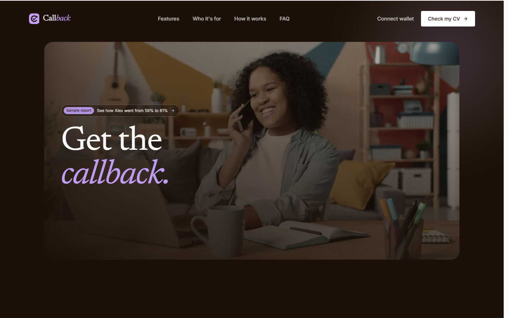
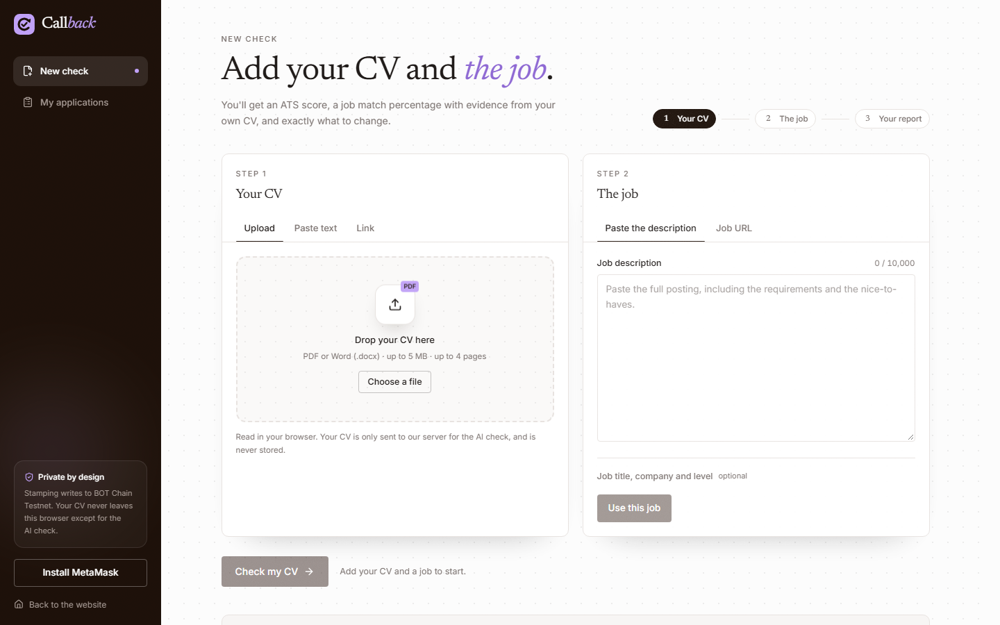
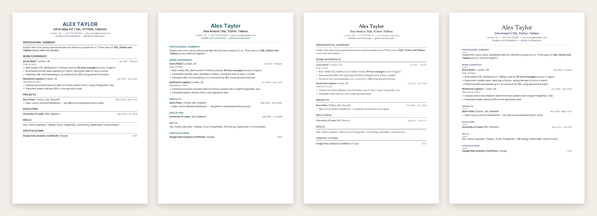
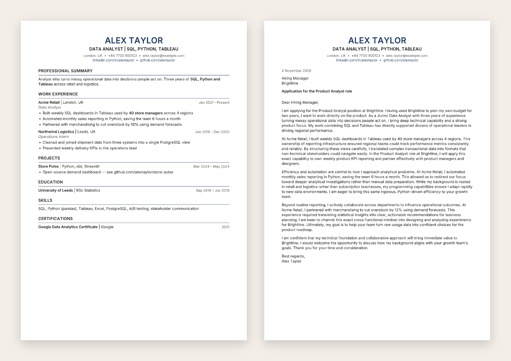

<p align="center">
  <a href="https://callback-six-theta.vercel.app">
    
  </a>
</p>

<h1 align="center">Callback</h1>

<p align="center">
  <strong>Get the callback.</strong><br>
  Check how ATS-friendly your CV is, how well it matches a job, and exactly what to change —<br>
  then re-check it, export a clean CV and cover letter, and optionally stamp your progress on BOT Chain.
</p>

<p align="center">
  <a href="https://callback-six-theta.vercel.app"></a>
  
  
  
  
  
  
  
</p>

<p align="center">
  <a href="https://callback-six-theta.vercel.app"><strong>Live site</strong></a> ·
  <a href="https://callback-six-theta.vercel.app/app">Check my CV</a> ·
  <a href="https://callback-six-theta.vercel.app/#sample">Sample report</a> ·
  <a href="https://scan.bohr.life/address/0xd949113c7AA4E2E9BF44bf5774D718211f4F38A5">Contract (testnet)</a> ·
  <a href="https://callback-six-theta.vercel.app/privacy">Privacy</a> ·
  <a href="https://callback-six-theta.vercel.app/terms">Terms</a>
</p>

<p align="center">
  
</p>

---

## Contents

- [Links](#links)
- [Features](#features)
- [How it works](#how-it-works)
- [CV templates and cover letter](#cv-templates-and-cover-letter)
- [Editing the CV](#editing-the-cv)
- [How the scores are calculated](#how-the-scores-are-calculated)
- [Privacy](#privacy)
- [The contract](#the-contract)
- [Running it locally](#running-it-locally)
- [Deploying to Vercel](#deploying-to-vercel)
- [How it's built](#how-its-built)
- [Project structure](#project-structure)
- [Testing](#testing)
- [Scope](#scope)
- [Disclaimer](#disclaimer)

---

## Links

| | |
|---|---|
| **Live site** | https://callback-six-theta.vercel.app |
| **Start a check** | https://callback-six-theta.vercel.app/app |
| **Sample report** | https://callback-six-theta.vercel.app/#sample |
| **My applications** | https://callback-six-theta.vercel.app/app/applications |
| **Contract — BOT Chain testnet (Bohr, chain 968)** | [`0xd949113c7AA4E2E9BF44bf5774D718211f4F38A5`](https://scan.bohr.life/address/0xd949113c7AA4E2E9BF44bf5774D718211f4F38A5) |
| **Contract — BOT Chain mainnet (chain 677)** | _not deployed yet — see [Deploying the contract](#deploying-the-contract)_ |
| **Explorers** | Testnet https://scan.bohr.life · Mainnet https://scan.botchain.ai |
| **Privacy policy / Terms** | [/privacy](https://callback-six-theta.vercel.app/privacy) · [/terms](https://callback-six-theta.vercel.app/terms) |
| **Product requirements** | [`PRD.md`](PRD.md) |

---

## Features

| | |
|---|---|
| 🤖 **ATS check** | Seven weighted, rule-based checks with ✓ / ⚠ / ✗, the points earned and a one-line fix for each. |
| 🎯 **Job match with evidence** | Every requirement in the job is matched against your CV **with a quote from your CV** — checked in code, so a made-up quote loses the match. |
| ✍️ **What to pivot** | Rewrites in the job's language, built only from what your CV already says. Keywords you can't back up go in an "add only if true" card instead of into your CV. |
| 📄 **Improved CV** | Accept the changes you agree with and see them highlighted in place, then re-check and watch both scores move. |
| 🎨 **Five ATS-safe templates** | Professional, Modern, Classic, Compact and Elegant, in six accent colours, with a centred or left header — exported as a **text-based PDF** and a native **Word .docx**. |
| ✉️ **Cover letter** | A one-page letter in three lengths and three tones, every body paragraph backed by a line from your CV. |
| 🛠️ **CV editor** | Bold, italic, links and bullets from a toolbar (Ctrl+B / I / K), plus add, rename, reorder and hide sections, with "Read as" labels showing how an ATS files each one. |
| 🔒 **Private by design** | Files are parsed in your browser. Reports live in your browser. Nothing about you is stored on a server. |
| ⛓️ **Optional on-chain stamp** | Two hashes, two scores, a job title and a date on BOT Chain — proof of your progress over time, with no personal data. |

<p align="center">
  
</p>

---

## How it works

1. **You add a CV** — upload a PDF or `.docx`, paste the text, or give a public
   link. Files are parsed **in your browser**; the file itself is never
   uploaded.
2. **You see what we read.** Extraction from a PDF is never perfect, so the
   text is shown back to you to correct before anything is scored.
3. **You add the job** — paste the description, or give the URL of a career
   page.
4. **You get a report** with an ATS score, a job match percentage, every
   requirement checked with a quote from your own CV as evidence, and suggested
   rewrites.
5. **You accept the changes you agree with**, edit the result, pick a
   template, re-check, and watch both scores move.
6. **You export** the improved CV as a PDF or `.docx`, write a matching cover
   letter, download the report — and optionally stamp the result on BOT Chain.

---

## CV templates and cover letter

<p align="center">
  
</p>

Every template is **single-column**, with standard headings, real bullet lists
and no tables, text boxes or images — the layout an applicant tracking system
reads most reliably. Templates differ only in type, colour and spacing, so
**changing the look never costs the score**.

- **One definition, three renderers.** Each template is described once, in
  points, in [`src/lib/cv-templates.ts`](src/lib/cv-templates.ts). The on-screen
  preview, the PDF ([`cv-pdf.ts`](src/lib/export/cv-pdf.ts)) and the Word file
  ([`cv-docx.ts`](src/lib/export/cv-docx.ts)) all read the same numbers, so what
  you see is what downloads.
- **The PDF is real text**, set in embedded Inter and Newsreader (both OFL), so
  it can be selected, searched and parsed. Heading letter-spacing is capped at
  0.05 em: from about 0.09 em, PDF text extraction reads "EXPERIENCE" as
  "E X P E R I E N C E".
- **The CV is read into a structure first** ([`cv-layout.ts`](src/lib/analysis/cv-layout.ts)):
  name, headline and contact details; sections; role / organisation / dates on
  one line with the dates on the right; the job title in italics underneath.
  Lines a PDF wrapped mid-sentence are joined back up.

<p align="center">
  
</p>

The **cover letter** uses the CV's header and template so the two read as a
set, laid out as a business letter: date, recipient, a bold subject line,
greeting, an opening hook, evidence-led body paragraphs and a closing with a
call to action. It comes in Short (260–300 words), Standard (340–400) and
Detailed (440–500).

It follows the same no-invention rule as everything else: **every body
paragraph must quote a line from your CV**, and the quote is checked in code
([`cover-letter.ts`](src/lib/analysis/cover-letter.ts)). A paragraph whose quote
is not in your CV is dropped, and the quotes are shown under the letter as
"Backed by your CV". It has its own daily limit, separate from analyses.

---

## Editing the CV

The Improved CV tab has an editor and a Sections panel.

| Action | How |
|---|---|
| **Bold / italic** | Select text, then **B** / **I** or Ctrl+B / Ctrl+I. Written as `**bold**` and `*italic*`. |
| **Link** | Select text, then 🔗 or Ctrl+K. Written as `[text](https://…)`. Emails, LinkedIn and GitHub in the header are linked automatically. |
| **Bullets** | Select lines, then **•** to bullet or un-bullet them all. |
| **New section from a line** | Put the cursor on a line and press **H**: it becomes a section heading. Press again to undo. |
| **Add a section** | **+ Add section** in the Sections panel: Projects, Certifications, Organizations, Awards, Volunteering, Languages, Courses, or a name of your own. The editor opens with a skeleton selected to type over. |
| **Rename, reorder, hide** | ✏️, ↑ ↓ and 👁 on each section. Hidden sections stay in your text but are left out of the preview, downloads, copy and re-check. |

Each section shows how an ATS will file it — **Experience, Education, Skills,
Summary** (the sections the score counts) or **Extra**. Indonesian headings
such as *Pengalaman Kerja*, *Pendidikan*, *Keahlian* and *Ringkasan* are
recognised too.

Formatting markers are stripped before anything is scored, sent to the AI or
copied, so **formatting can never change a score**. In the PDF and `.docx`
they become real bold, italics and clickable links
([`inline.ts`](src/lib/analysis/inline.ts)).

---

## How the scores are calculated

Both numbers are computed in code, not by the AI, so the same inputs always
produce the same output. The AI's job is to read and judge; the arithmetic is
ours and is published here.

### ATS score — 0 to 100

| Check | Points | What it looks for |
|---|--:|---|
| Text is readable | 20 | Enough extractable text. An image-only (scanned) PDF fails this outright. |
| Standard sections found | 20 | Experience, Education and Skills (6 each), plus a Summary (2). |
| Contact details present | 10 | Email (3), phone (3), city or location (2), LinkedIn or portfolio (2). |
| Dates are consistent | 10 | Dates present, in one dominant format, with real ranges rather than bare years. |
| No formatting risks | 15 | Starts at 15, then deducts: two columns −6, tables −4, images −3, details in a header/footer −2. |
| Length is right | 10 | 1–2 pages full marks, 3 pages partial, 4+ fails. Estimated from word count when no page count is available. |
| Bullet quality | 15 | Bullets that start with a strong verb and carry a number or result. **The one AI-assisted check**; if the AI is unavailable, a rule-based fallback scores it from action verbs and quantified results. |

Source: [`src/lib/analysis/ats.ts`](src/lib/analysis/ats.ts).

### Job match — 0 to 100%

```
score = must-haves (60%) + nice-to-haves (20%) + keyword coverage (20%)
```

- Each requirement is **matched** (full credit), **partial** (half credit) or
  **missing** (none).
- **Empty buckets are redistributed, not scored as zero.** If a job has no
  nice-to-haves, that weight is spread across the buckets that do have content
  — otherwise a perfect CV would be capped at 80% for a reason that has nothing
  to do with the CV.
- **Keyword coverage is computed in code**, case-insensitively, with a synonym
  list — "Postgres" covers "PostgreSQL", "JS" counts as "JavaScript".
- A **seniority mismatch is a warning, not a deduction.**

Source: [`src/lib/analysis/match.ts`](src/lib/analysis/match.ts),
[`src/lib/analysis/keywords.ts`](src/lib/analysis/keywords.ts).

### Why you can trust the match

The prompt tells the model that a requirement only counts if it can quote the
supporting line from the CV. **That instruction is then enforced in code**:
every quote is checked against the CV text, and a claimed match whose quote is
not actually there is demoted before it reaches your score. See
`verifyEvidence` in [`match.ts`](src/lib/analysis/match.ts).

### The no-invention rule

Rewrites may only rephrase facts already in your CV. A keyword your CV does not
support is **never written in for you** — it appears in an "add only if true"
card, and accepting it changes nothing in the CV text. Suggestions never
rewrite, move or delete a section heading. See
[`prompts.ts`](src/lib/ai/prompts.ts) and [`apply.ts`](src/lib/analysis/apply.ts).

---

## Privacy

- **Files never leave your browser.** PDF parsing uses pdf.js and `.docx`
  parsing uses mammoth, both client-side.
- **Your CV text is sent to one place:** our API route, to make the AI call.
  It is not written to a database, a file or a log. Requests go to Gemini with
  `store: false`.
- **Reports live in your browser** (`localStorage`), never on a server.
- **"Delete all my data"** on the My applications page removes every report and
  the hash salt.
- **Rate limiting stores a counter per IP and nothing else** — 8 analyses and
  8 cover letters per IP per day.

### What goes on-chain

Only if you press **Stamp on BOT Chain**:

| Stored | Not stored |
|---|---|
| Hash of the report | Your name |
| Salted SHA-256 of your CV text | Your email or phone |
| ATS score, match score | Any CV text |
| Job title (≤ 60 bytes) | The company name |
| Id of the earlier report it improved on | Anything else |
| Timestamp, and the sending wallet address | |

The CV hash is salted with a random value generated in your browser that
**never leaves it**, so nobody holding a copy of your CV can confirm it matches
an on-chain record.

> **Honest caveat:** the scores are computed by this app. A stamp proves **your
> own progress over time** — not that an employer agreed with the score, and it
> is not a credential.

---

## The contract

[`contracts/contracts/Callback.sol`](contracts/contracts/Callback.sol),
Solidity `^0.8.20`. No tokens, no payments, no admin role, no upgrade path.
Anyone can stamp their own reports; nobody can alter or remove them.

```solidity
function stamp(
    bytes32 reportHash,
    bytes32 cvHash,
    uint8   atsScore,     // ≤ 100
    uint8   matchScore,   // ≤ 100
    uint256 improvedFrom, // 0, or an earlier report of yours
    string calldata jobTitle // ≤ 60 bytes
) external returns (uint256 id);

function getReport(uint256 id) external view returns (Report memory);
function reportsOf(address owner) external view returns (uint256[] memory);
function stats() external view returns (uint256 totalReports, uint256 totalRechecks);
```

Report ids start at **1**: index 0 is an unusable placeholder owned by
`address(0)`, because `improvedFrom == 0` means "a first check".
`improvedFrom` must be an existing report **owned by the caller**, so you
cannot claim someone else's score as your "before".

| Network | Chain ID | RPC | Explorer | Address |
|---|---|---|---|---|
| BOT Chain testnet (Bohr) | 968 | `https://rpc.bohr.life` | https://scan.bohr.life | [`0xd949…38A5`](https://scan.bohr.life/address/0xd949113c7AA4E2E9BF44bf5774D718211f4F38A5) |
| BOT Chain mainnet | 677 | `https://rpc.botchain.ai` | https://scan.botchain.ai | _not deployed yet_ |

### Deploying the contract

Deployment is done by hand in Remix, so **no private key is needed anywhere in
this repo**.

1. Open [Remix](https://remix.ethereum.org) and paste in `Callback.sol`.
2. Compile with Solidity 0.8.20 or later.
3. Deploy to **BOT Chain testnet** first and stamp a test report and a re-check.
4. Deploy to **BOT Chain mainnet**.
5. Put the address in `NEXT_PUBLIC_CONTRACT_ADDRESS` (and remove
   `NEXT_PUBLIC_USE_TESTNET` for mainnet), then update the tables above.

Until the address is set, the stamping UI is **disabled with an explanation**
rather than broken, and every other feature works.

---

## Running it locally

Requires Node 22 or later.

```bash
git clone https://github.com/Devs-GMT/Callback.git
cd Callback
npm install
cp .env.example .env.local   # then add your Gemini key
npm run dev                  # http://localhost:3000
```

| Script | What it does |
|---|---|
| `npm run dev` | Dev server (copies the pdf.js worker into `public/` first) |
| `npm run build` | Production build |
| `npm run typecheck` | `tsc --noEmit` |
| `npm run lint` | ESLint |
| `npm test` | Unit tests — scoring, CV layout, formatting, cover letter, schemas, SSRF ranges |
| `npm run contracts:test` | The Solidity test suite |

### Environment

See [`.env.example`](.env.example). **No key is committed, and `.env*.local` is
gitignored.**

| Variable | Required | Purpose |
|---|---|---|
| `GEMINI_API_KEY` | For the AI features | Free tier key from [AI Studio](https://aistudio.google.com/apikey) |
| `UPSTASH_REDIS_REST_URL` / `_TOKEN` | Recommended in production | Makes the per-IP limit real on serverless |
| `NEXT_PUBLIC_CONTRACT_ADDRESS` | For stamping | Deployed `Callback.sol` address |
| `NEXT_PUBLIC_USE_TESTNET=1` | Optional | Use BOT Chain testnet (968) instead of mainnet (677) |
| `NEXT_PUBLIC_SITE_URL` | Optional | Canonical origin for share links; inferred on Vercel |
| `GEMINI_MODEL_ANALYZE` / `_PIVOT` | Optional | Model overrides (default `gemini-3.5-flash-lite`) |
| `GEMINI_THINKING_ANALYZE` / `_PIVOT` | Optional | `minimal` · `low` · `medium` · `high` |

**Without a Gemini key** the app still runs: the rule-based ATS check works in
full, and the job match tab explains itself and offers a retry.
**Without Upstash** the limit falls back to an in-process counter that resets on
every cold start — fine locally, not a real limit on Vercel.

---

## Deploying to Vercel

1. Import the repository. Root directory: `./` (framework: Next.js).
2. Add the environment variables above for Production and Preview.
3. Deploy. `prebuild` copies the pdf.js worker automatically.
4. After changing an environment variable, **Redeploy** so it takes effect.

The `contracts/` directory is its own package and is **not** installed by the
Vercel build. This app needs a server for its API routes, so it is not suited to
static hosting such as GitHub Pages.

---

## How it's built

| Area | Choice | Why |
|---|---|---|
| Framework | Next.js 16, App Router, React 19, TypeScript | Cache Components on, so the marketing pages are static and the app shell prerenders |
| Styling | Tailwind CSS v4 | Design tokens live in `@theme` in `globals.css`; the CV preview scales with container query units |
| AI | Gemini via `@google/genai` | A genuine free tier, and a JSON Schema the decoder enforces. Behind one adapter ([`provider.ts`](src/lib/ai/provider.ts)), with a fallback when a schema is refused |
| Validation | Zod v4 | Every AI response is validated and repaired, so one odd field degrades a row rather than the report |
| Extraction | pdf.js, mammoth | Client-side, which keeps the privacy promise literal |
| CV & letter export | jsPDF (embedded fonts) and `docx` | Selectable vector text and native Word lists and headings, not a screenshot |
| Rate limiting | Upstash Redis | Separate daily budgets for analyses and cover letters |
| Chain | ethers v6 | MetaMask, chain add/switch, and read-only RPC for share links |
| Artwork | Hand-authored SVG | The logo, the handset mark and the torn-paper edge are drawn in this repo |

### Notable implementation details

- **Two-column PDFs are detected, not silently fixed.** [`pdf.ts`](src/lib/extract/pdf.ts)
  finds a vertical gutter, reads each column in order, *and* raises a warning,
  because an ATS would interleave the columns.
- **The link reader is fenced in.** [`safe-fetch.ts`](src/lib/server/safe-fetch.ts)
  validates every redirect hop and every DNS address, and allows only
  http/https on default ports.
- **An AI failure is a first-class outcome.** A failed analysis still produces a
  saved report with the full rule-based ATS check and a retry.
- **Text copied from a PDF is handled as it really comes out:** no blank lines
  between sections, sentences wrapped mid-line, names in capitals. The layout
  and the suggestion engine are tested against exactly that.

---

## Project structure

```
src/
  app/                 Routes: website, /app, /app/report/[id], /api/fit/*
  components/
    site/              Marketing website sections
    app/               The app: flow, report tabs, CV editor, templates
    ui/                Buttons, cards, fields, gauges, tabs
  lib/
    ai/                Gemini adapter, prompts, response schemas
    analysis/          ATS, match, keywords, CV layout, formatting, cover letter
    export/            CV / cover letter PDF and .docx, report PDF
    extract/           PDF, .docx and link extraction
    chain/             Wallet and contract calls
    server/            HTTP helpers, rate limit, safe fetch
contracts/             Callback.sol and its Hardhat tests
tests/                 Unit tests (node:test via tsx)
docs/images/           README images
public/fonts/cv/       Inter and Newsreader for the PDF export (OFL)
```

---

## Testing

```bash
npm test                 # app unit tests
npm run contracts:test   # Solidity tests
npm run typecheck && npm run lint && npm run build
```

The app tests cover the scoring arithmetic, evidence verification, CV layout
(including PDF-extracted text), applying suggestions, inline formatting and the
editor commands, section edits, cover-letter verification, the AI response
schemas and the SSRF address ranges. The contract suite covers the id scheme,
score and title bounds, the re-check ownership rules, the views, and the absence
of any privileged entry point.

---

## Scope

**Built:** ATS check, job match with evidence, pivot suggestions, improved CV
with editor, five templates with PDF and `.docx` export, cover letter, report
PDF, local history, and on-chain stamping.

**In progress:** Indonesian — CV headings are already recognised; the interface
is English for now.

**Not included, by design:** auto-applying to jobs, scraping LinkedIn,
recruiter accounts, server-side CV storage, payments, NFTs.

---

## Disclaimer

Callback is an independent project and is not affiliated with, sponsored by or
endorsed by any job board or ATS vendor. Names of third-party products are used
to describe compatibility only and remain the trademarks of their respective
owners. **Scores are guidance, not a hiring guarantee.** Your CV is never stored
and never put on-chain.

<p align="center">
  <a href="https://callback-six-theta.vercel.app">
    
  </a><br>
  <sub>Made for job seekers who deserve a callback.</sub>
</p>
